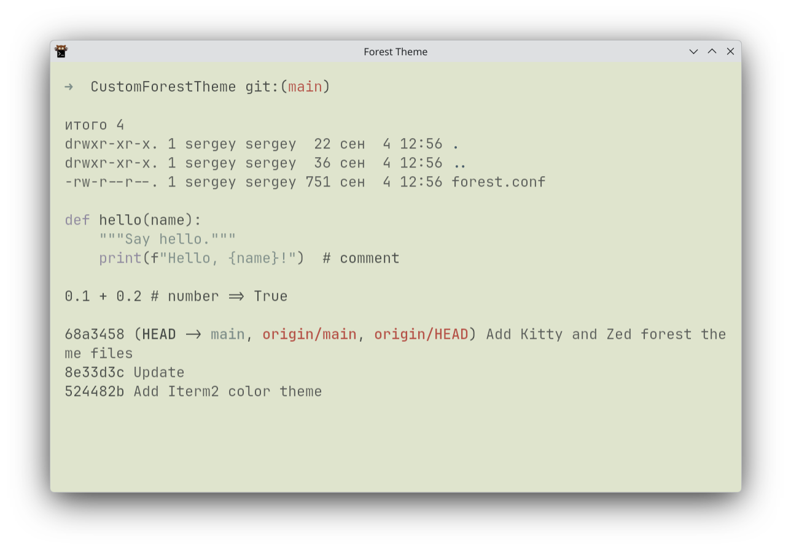
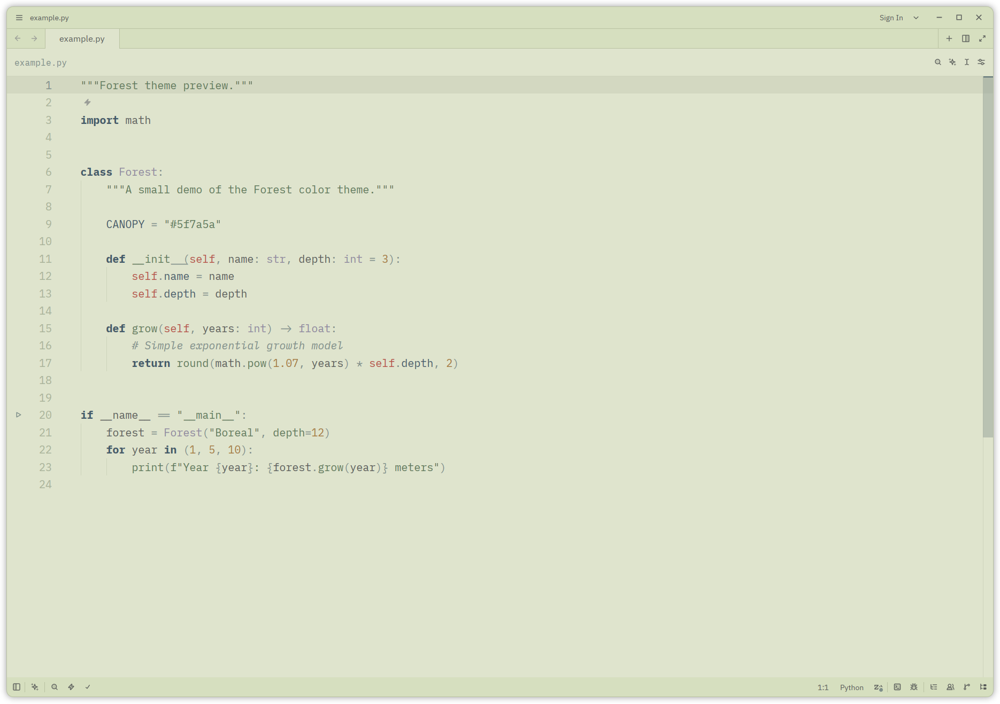

# Forest Theme

A quiet, low-contrast theme built around muted olive-greens, soft greys, and a
small set of desaturated accent colors (blue, red, purple, amber). Designed to
be easy on the eyes for long terminal and editor sessions, without the harsh
contrast of typical themes.

Two variants are included:

- **Forest** — a light theme on a pale olive background.
- **Forest Dark** — its dark counterpart on a deep olive "forest at night"
  background. The same hues and the same restrained contrast, adjusted for a
  dark canvas.

## Palette

### Forest (light)

| Role        | Color                               |
| ----------- | ------------------------------------ |
| Background  | `#dfe4cd` |
| Foreground  | `#5a5d5a` |
| Comments / muted | `#7f8f8a` |
| Accent (blue)   | `#435a69` |
| Green   | `#5f7a5a` |
| Red     | `#b65045` |
| Yellow / amber | `#a67c3d` |
| Purple  | `#8f899f` |

### Forest Dark

| Role        | Color                               |
| ----------- | ------------------------------------ |
| Background  | `#1e231b` |
| Foreground  | `#b0b8a2` |
| Comments / muted | `#7d8770` |
| Accent (blue)   | `#7b9cb0` |
| Green   | `#8aab81` |
| Red     | `#c06f64` |
| Yellow / amber | `#c99f5b` |
| Purple  | `#a8a2b8` |

## Screenshots

**Kitty**



**Zed**



## Contents

- `Iterm2/` — iTerm2 color scheme (contains both Light and Dark variants)
- `Kitty/forest.conf` — light Kitty terminal color scheme (`include` it from
  your `kitty.conf`)
- `Kitty/forest-dark.conf` — dark Kitty terminal color scheme
- `Opencode/forest.json` — OpenCode V2 TUI theme with both light and dark
  variants. Copy it to `~/.config/opencode/themes/` and select **forest**, or
  point `theme.name` at it in `~/.config/opencode/cli.json`. The terminal UI is
  a separate surface from the terminal palette, so OpenCode needs its own theme
  to match Forest.
- `Zed/forest.json` — Zed editor/UI theme containing both **Forest** and
  **Forest Dark** (drop into `~/.config/zed/themes/`, then select either as
  your theme). To follow the system appearance, set in your Zed `settings.json`:

  ```json
  {
    "theme": { "mode": "system", "light": "Forest", "dark": "Forest Dark" }
  }
  ```
